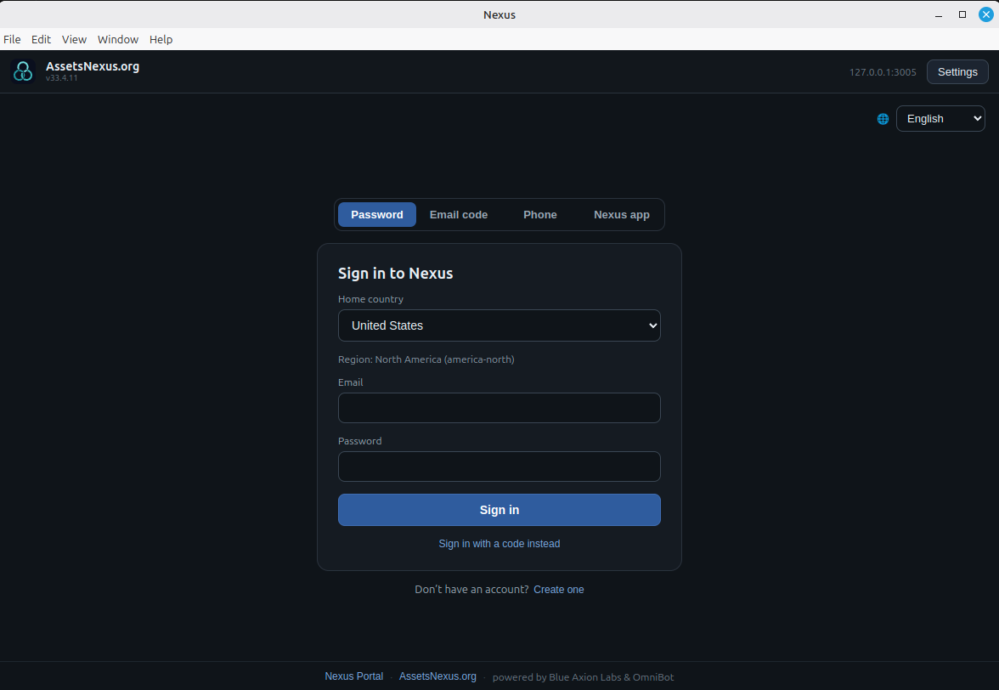
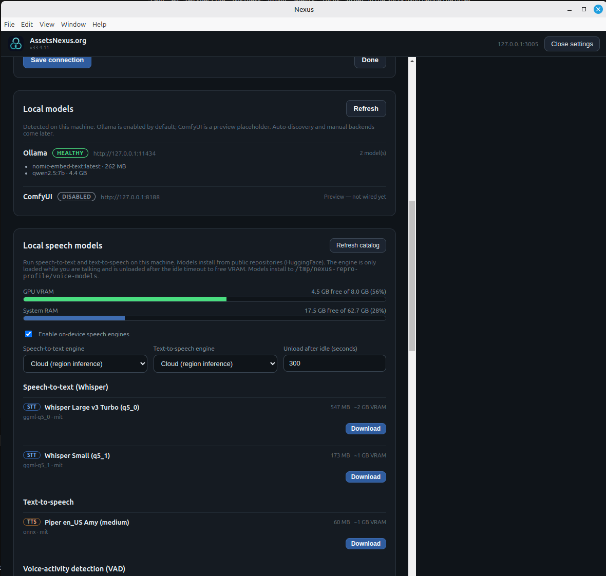
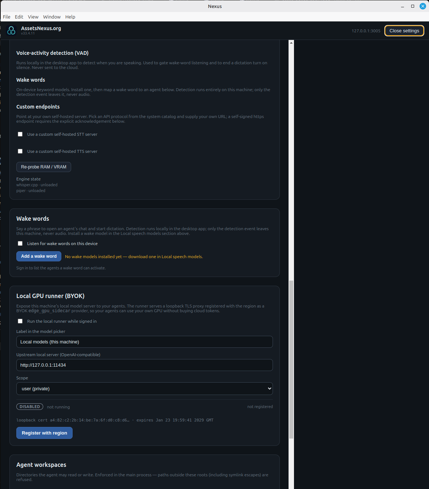
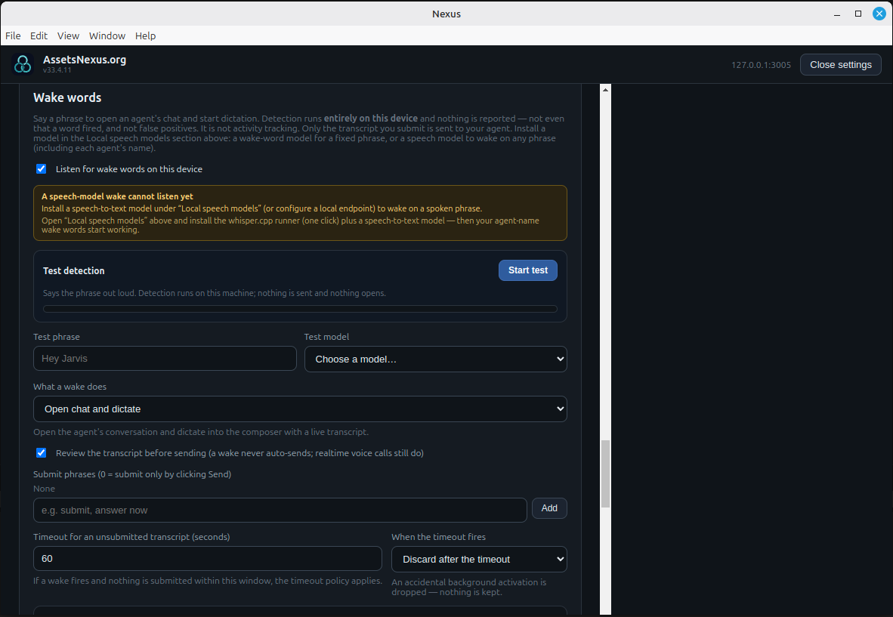
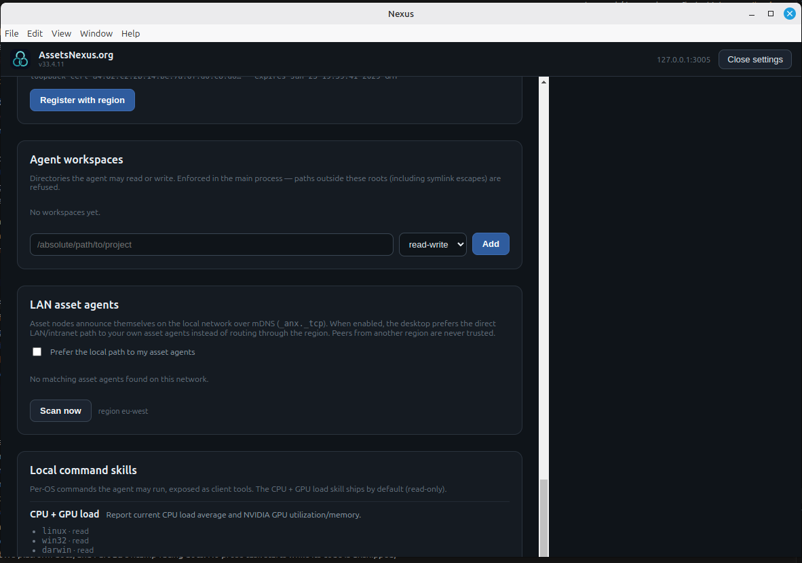

# Nexus Desktop — Nexus Sandbox Preview

The cross-platform desktop client for **Nexus Agents** on
**[AssetsNexus.org](https://assetsnexus.org)** — Linux, Windows, and macOS.

> **This is a Nexus Sandbox Preview.**
> It connects to the Nexus **sandbox** region by default and is an early-access
> build: issues are expected, and you use it at your own risk, as-is, without
> warranty. Sandbox subscription plans are real charges — see the disclaimer
> shown on the sign-in screen.

## What is AssetsNexus.org / Nexus Agents?

AssetsNexus.org is the operating system for the AI economy: people, organisations,
assets, and machines on one governed stack. **Nexus Agents** are the AI employees
that live on that stack — each with its own memory/brain, tools, permissions
(RBAC), privacy classes, approvals, and skills, working alongside humans in chat,
meetings, and on real assets.

This desktop app is the **native client** for talking to those agents and for
running the parts of the stack that belong on *your* machine.

## What this client does

- **Sign in your way** — password, email code, phone code, or a QR device-link
  approved in the Nexus phone app. Full 2FA, country → region routing.
- **Chat with your agents** — the same conversation stack as the web clients, with
  VRM avatars and live voice.
- **Companion window** — an immersive popout with the agent's VRM avatar and
  realtime voice (fullscreen or split layout).
- **Meetings & rooms** — calendar-linked Nexus meeting rooms with participants,
  camera, screenshare, and a Scene tab (VR headset preview where a WebXR runtime
  is available).
- **3D avatars** — your agents are embodied as VRM avatars in the scene: gestures,
  locomotion, gaze and look-at, moods and facial expressions, clothes, and idle
  presence (breathing, weight shifts, automatic blink).
- **Scene objects & tool-call visuals** — agents place objects in the scene and
  bind them to tool calls, so a running tool shows up physically: spawn a sphere in
  front of the agent, glow or pulse it while the call is in flight, blink or fade
  it on completion, with a per-tool colour. Built-in effect clips are `glow`,
  `pulse`, `spin`, `bob`, `blink`, and `fade`, and you can define your own.
  *(Preview — the desktop wires the scene, embodiment rail, and scene objects; the
  full agent-driven tool-call visualisation is still rolling out.)*
- **Calendar** — your agenda and upcoming meetings, straight from the region.
- **Storage explorer** — browse buckets, trash, and per-file revision history, and
  revert to an earlier revision.
- **Sync** — bind a local folder to a bucket folder (two-way, download-only, or
  upload-only) with a configurable conflict policy.
- **Mounts** — project a bucket as a real filesystem directory through the optional
  native `nexus-mount` helper, with a pure-JS mirror fallback.
- **Wake words** — arm a spoken phrase per agent (or auto-map it from the agent's
  name) and let on-device speech recognition wake it, then choose what a wake does.
- **Local speech models** — run speech-to-text and text-to-speech on this machine
  (whisper.cpp / piper), or point at cloud / custom OpenAI-compatible endpoints.
  Engines unload after idle to free VRAM.
- **Local models** — register your own Ollama / ComfyUI instances and choose how
  jobs are routed across them (first available, least busy, round robin).
- **Local GPU runner (BYOK)** — expose your own GPU to your agents: a loopback TLS
  proxy registered with the region as an `edge_gpu_sidecar` provider, so you don't
  have to buy cloud tokens.
- **LAN asset agents (P2P)** — asset nodes announce themselves over mDNS
  (`_anx._tcp`); the desktop can prefer the direct LAN/intranet path to *your own*
  asset agents instead of routing through the region. Cross-region peers are never
  trusted.
- **Agent workspaces & local command skills** — a hard, main-process-enforced
  sandbox for the directories an agent may touch and the per-OS commands it may run.
- **Notifications & tray** — closing the window keeps the app running in the tray so
  it still receives messages and raises notifications.
- **17 UI languages**, including right-to-left Arabic.

## Screenshots

**Sign in — sandbox badge, four sign-in methods, country → region routing**


**Local models — register your own Ollama / ComfyUI instances and pick a routing policy**


> *Note: the client itself uses **under 500 MB of RAM**. The 40+ GB of RAM shown in
> this screenshot is the local model servers it is talking to — that memory belongs
> to your own Ollama / ComfyUI boxes, not to the app.*

**Local speech models — on-device STT/TTS engines, endpoints, and idle unload**


**Wake words — a spoken phrase per agent, custom wake words, and live detection test**


**LAN asset agents — prefer the direct P2P path to your own asset nodes**


## Run it

### Prebuilt (Nexus Sandbox Preview)

Grab the artifact for your OS from the latest
[release](https://github.com/assetsnexus/nexus-client-desktop/releases).

**Linux**

```bash
chmod +x Nexus-*.AppImage && ./Nexus-*.AppImage     # AppImage
sudo dpkg -i nexus-desktop_*.deb                    # Debian/Ubuntu
sudo rpm -i nexus-desktop-*.rpm                     # Fedora/RHEL
```

**macOS** — open the `.dmg` and drag Nexus to Applications. The preview build is
**unsigned**, so the first launch needs a right-click → **Open** (or
`xattr -dr com.apple.quarantine /Applications/Nexus.app`).

**Windows** — run the `Nexus Setup *.exe` installer, or launch the portable `.exe`
directly. If SmartScreen warns about an unknown publisher, choose **More info** →
**Run anyway**.

### From source

Requires **Node.js >= 18**. This repo resolves its shared Nexus libraries from
sibling repositories (`../anx-npm-modules`, `../anx-libs`), so check those out next
to this one before installing.

```bash
npm install
npm run dev          # Electron + renderer dev server
```

```bash
npm test             # unit tests
npm run typecheck
npm run package      # electron-builder targets for the current OS
```

Package targets: `dmg`/`zip` (macOS, arm64 + x64), `nsis` installer + portable
`.exe` (Windows), `AppImage`/`deb`/`rpm` (Linux).

## Connection defaults

| Setting | Default |
| --- | --- |
| Region node | `https://1.west.eu.region.sandbox.assetsnexus.org` |
| Gateway | same as the resolved region (gateways are not deployed yet) |
| Portal | `https://portal.sandbox.assetsnexus.org` (the region may advertise its own) |

All three are overridable in **Settings → Connection**, and a custom CA (PEM) can be
supplied for local/self-signed region nodes. Copy `apps/desktop/.env.example` to
`apps/desktop/.env` to point the client at a locally-running region node.

## Repository layout

```
apps/desktop        Electron app (main + preload + renderer)
apps/cli            nexus terminal client
packages/           headless cores shared with the CLI and the desktop
native/nexus-mount  optional native filesystem mount helper (Rust + FUSE)
```

## Meetings and rooms

A Nexus meeting is a calendar entry that links to a normal conversation room, so
meetings reuse the same room rails as DMs with agents. The cross-host meeting model
lives in `@nexus/meetings-core` with React/Vue adapters:

- **Meetings tab** — upcoming meetings rendered with the shared `MeetingCard`.
  Zoom/Teams/Google Meet/Webex/custom links open externally; Nexus rooms open
  in-app; in-person/custom meetings show their description.
- **Room view** — the room roster (humans + agents) projected into a
  `RoomMediaSession` and rendered with the shared `MeetingView`: video,
  participants, screenshare, and a Scene tab. Agents can be muted and have listening
  disabled, mirroring group-conversation moderation.
- **VR headset preview** — the Scene tab offers "Preview in VR headset" when the
  local WebXR runtime can start an `immersive-vr` session.

The desktop has no 3D cluster-scene renderer yet, so the Scene tab shows the room's
bound scene id; the portal renders the live cluster scene.

## License

**Nexus Open Use License v1.0** — see [LICENSE.md](LICENSE.md).

Free to use, edit, and self-host, including commercial use and building your own
custom clients in combination with AssetsNexus.org or OmniBot.ai Systems.
Self-hosted deployments are covered with no royalty and no obligation to publish
your changes.

Trademarks and access to the hosted AssetsNexus.org / OmniBot.ai Systems services
are **not** granted by the license and remain governed by their own terms.

---

Copyright © AssetsNexus.org and OmniBot.ai Systems. The Nexus Sandbox Preview is
provided as-is for early access; see the terms shown on the sign-in screen.
